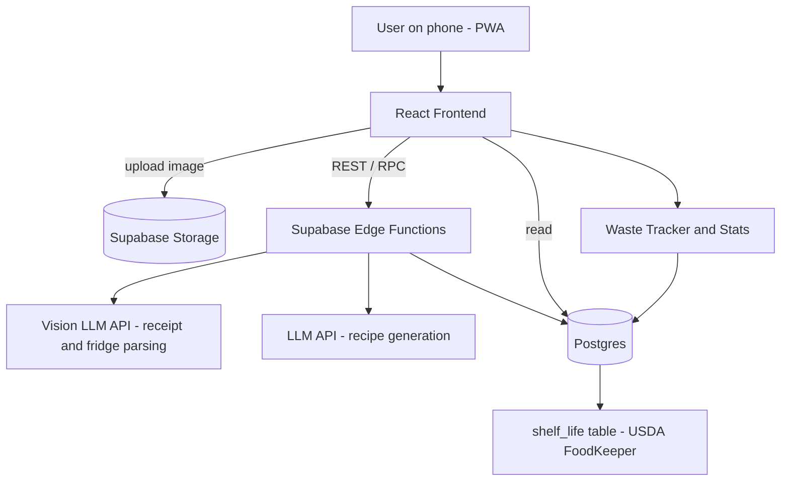

# Fridge Rescue: Architecture & 20-Day Plan

> Arbiter Hacks V1, **Theme Track: Rethinking Waste**
> Scan a receipt or snap your fridge. Fridge Rescue predicts what will expire, tells you what to eat first, and measures how much food you saved.

---

## 1. Project Overview

### 1.1 Problem
Households are a major source of food waste. Most of it happens because people forget what they own, not because they don't care.

### 1.2 Solution
Fridge Rescue turns groceries into a live inventory with expiry predictions:
1. **Ingest** food via receipt scan, fridge photo, or manual add.
2. **Predict** expiry dates from a shelf-life database.
3. **Prioritise** with a red/yellow/green dashboard.
4. **Suggest** recipes that use soon-to-expire items first.
5. **Measure** impact by logging every item as *used* or *tossed*.

### 1.3 Theme Paragraph (required for submission)
> Households are among the largest sources of food waste, mostly because people forget what they own. Fridge Rescue targets this by predicting expiry and surfacing recipes before food spoils. We measure success as **items wasted per household per week**, comparing a baseline week with weeks of use.

### 1.4 Success Metrics
| Metric | Definition | Target |
|---|---|---|
| Waste rate | Items tossed / items tracked, per household per week | Drop vs. baseline week |
| Items saved | Items marked *used* that were flagged yellow/red beforehand | Show count in demo |
| Receipt parse accuracy | Correctly extracted food items / total food items on receipt | ≥ 85% |
| Expiry match rate | Items mapped to a shelf-life entry | ≥ 90% |
| Scan-to-inventory time | Photo taken to items saved | < 15 seconds |

### 1.5 Scope
**In scope (MVP):** receipt scan, fridge photo, manual add, expiry dashboard, recipe suggestions, waste tracker, weekly stats, PWA.
**Stretch:** barcode scanning, push reminders, donation hand-off (LeftoverLink-style), household sharing.
**Out of scope:** grocery delivery integration, nutrition tracking, native mobile apps.

---

## 2. System Architecture

### 2.1 High-Level Diagram



### 2.2 Core Flows

**Receipt flow**
`Photo → upload → vision LLM extracts line items (JSON) → normalise names → match to shelf_life → compute expiry → user reviews/edits → save to inventory`

**Fridge photo flow**
`Photo → vision LLM lists visible foods (JSON) → match to shelf_life → user confirms → save (expiry counted from today, flagged "estimated")`

**Recipe flow**
`Inventory sorted by expiry → top N items → LLM prompt → structured recipes (JSON) → display with "uses X expiring items" badge → "I cooked this" marks items used`

**Waste tracking flow**
`Item reaches end state (used / tossed) → waste_event row → weekly aggregation → stats dashboard and baseline comparison`

### 2.3 Tech Stack
| Layer | Choice | Why |
|---|---|---|
| Frontend | React + Vite + TypeScript, PWA | Works on phones, no app store |
| Styling | Tailwind CSS | Fast iteration |
| Backend | Supabase (Postgres, Auth, Storage, Edge Functions) | One platform, quick setup |
| Receipt/fridge vision | Vision LLM API (primary), Tesseract.js (fallback) | Handles messy receipts |
| Shelf-life data | USDA FoodKeeper (JSON/CSV) | Public and credible |
| Recipes | LLM with strict JSON output | Flexible, fast to build |
| Testing | Vitest, React Testing Library, Playwright | Unit, component, end-to-end |
| CI | GitHub Actions | Lint, tests on every push |
| Hosting | Vercel or Netlify (frontend) | Free tier, easy deploy |

### 2.4 Repository Structure
```
fridge-rescue/
├── README.md
├── architecture.md
├── .github/workflows/ci.yml
├── data/
│   ├── foodkeeper.json          # raw shelf-life data
│   └── sample-receipts/         # test images
├── supabase/
│   ├── migrations/              # SQL schema
│   └── functions/
│       ├── parse-receipt/
│       ├── parse-fridge/
│       └── suggest-recipes/
├── src/
│   ├── components/
│   ├── pages/                   # Scan, Inventory, Recipes, Stats
│   ├── lib/
│   │   ├── expiry.ts            # expiry calculation
│   │   ├── normalize.ts         # item name cleanup and matching
│   │   └── stats.ts             # waste metrics
│   ├── hooks/
│   └── types/
└── tests/
    ├── unit/
    ├── integration/
    └── e2e/
```

---

## 3. Data Model

```sql
households (id, name, created_at)
users (id, household_id, email, created_at)

shelf_life (
  id, name, category, aliases text[],
  fridge_days, freezer_days, pantry_days, notes
)

items (
  id, household_id, name, normalized_name, shelf_life_id,
  category, quantity, unit,
  storage text,            -- fridge | freezer | pantry
  purchased_on date, expires_on date,
  expiry_source text,      -- receipt | estimated | manual
  status text,             -- active | used | tossed
  source_receipt_id, created_at
)

receipts (id, household_id, image_path, raw_extraction jsonb, created_at)

waste_events (
  id, household_id, item_id,
  outcome text,            -- used | tossed
  was_flagged boolean,     -- was yellow/red when resolved
  created_at
)

recipe_cache (id, household_id, ingredient_hash, recipes jsonb, created_at)
```

### Expiry Status Rules
| Status | Condition |
|---|---|
| Green | More than 3 days left |
| Yellow | 1 to 3 days left |
| Red | Expires today or already expired |

---

## 4. API Design (Edge Functions)

| Endpoint | Input | Output |
|---|---|---|
| `POST /parse-receipt` | image path | `[{name, qty, unit, price}]` |
| `POST /parse-fridge` | image path | `[{name, confidence}]` |
| `POST /suggest-recipes` | item list sorted by expiry | `[{title, uses[], steps[], time_min}]` |
| `POST /items/resolve` | item id, outcome | updated item and waste_event |
| `GET /stats/weekly` | household id | `{week, tracked, used, tossed, waste_rate}` |

All LLM calls must return strict JSON, validated with a schema (e.g. Zod) before use.

---

## 5. Key Design Decisions

- **User confirms before saving.** OCR and vision make mistakes, so a review screen is mandatory.
- **Expiry is an estimate.** Items show their source (receipt, estimated, manual) so users know how much to trust it.
- **Cache recipe results** by ingredient hash to cut cost and latency.
- **Graceful fallback.** If vision fails, drop to Tesseract.js, then to manual entry.
- **Privacy.** Receipt images are private per household, with row-level security on every table. Delete images after parsing if the user opts out.

---

## 6. Testing Strategy

| Level | Tool | Covers |
|---|---|---|
| Unit | Vitest | expiry math, name normalisation, stats |
| Component | React Testing Library | review screen, dashboard, tracker |
| Integration | Vitest and test DB | edge functions, RLS, schema |
| End-to-end | Playwright | scan → save → recipe → mark used → stats |
| Accuracy eval | Script and labelled receipts | OCR parse accuracy, match rate |
| Manual | Real phone | camera, PWA install, lighting |

**Definition of done for any task:** code merged, tests written and passing, no console errors, works on a real phone.

---

## 7. 20-Day Plan

> Pace: roughly 3 to 5 focused hours per day. Each day ends with a short "tested" checklist. Milestones fall on Days 7, 12, 16 and 20.

### Phase 1: Foundation (Days 1–3)

#### Day 1: Planning and Setup
**Tasks**
- [ ] Register for Arbiter Hacks, pick **Theme Track**, note the deadline
- [ ] Create public GitHub repo, add README stub and `architecture.md`
- [ ] Scaffold Vite + React + TypeScript + Tailwind
- [ ] Set up ESLint, Prettier, Vitest
- [ ] Add GitHub Actions CI (lint and test)
- [ ] Write the Theme paragraph draft

**Test**
- [ ] `npm run dev` loads a blank page
- [ ] CI runs green on first push
- [ ] A dummy Vitest test passes

#### Day 2: Shelf-Life Data
**Tasks**
- [ ] Download USDA FoodKeeper data
- [ ] Write a script to clean it into `foodkeeper.json` (name, category, aliases, fridge/freezer/pantry days)
- [ ] Add 30 or more common aliases (e.g. "organic whole milk" → "milk")
- [ ] Build `expiry.ts`: `computeExpiry(purchasedOn, shelfLife, storage)`

**Test**
- [ ] Unit tests: milk in fridge returns the expected date
- [ ] Unit tests: missing storage type falls back to the default
- [ ] Unit tests: leap-year and month-end dates compute correctly
- [ ] Data file has no empty names or negative days

#### Day 3: Database and Auth
**Tasks**
- [ ] Create Supabase project
- [ ] Write migrations for all tables in section 3
- [ ] Seed `shelf_life` from `foodkeeper.json`
- [ ] Enable auth (email magic link) and household creation on signup
- [ ] Add row-level security policies

**Test**
- [ ] Seed count in DB matches JSON count
- [ ] User A cannot read User B's items (RLS test)
- [ ] Signup creates a household and user row
- [ ] Migration runs cleanly from scratch

---

### Phase 2: Ingestion (Days 4–7)

#### Day 4: Scan UI and Upload
**Tasks**
- [ ] Build Scan page with camera capture and file upload
- [ ] Compress and resize images client-side
- [ ] Upload to Supabase Storage in a household-scoped folder
- [ ] Add loading, error and retry states

**Test**
- [ ] Upload works from a real phone camera
- [ ] A large (5 MB or more) image is compressed before upload
- [ ] Upload failure shows a retry button
- [ ] Another household cannot access the file URL

#### Day 5: Receipt Parsing
**Tasks**
- [ ] Build `parse-receipt` edge function calling the vision API
- [ ] Write the prompt: return JSON of food items only, ignore tax, totals, non-food
- [ ] Validate output with a Zod schema
- [ ] Store `raw_extraction` in `receipts`
- [ ] Collect 10 sample receipts into `data/sample-receipts/`

**Test**
- [ ] Function returns valid JSON for all 10 samples
- [ ] Non-food items (bags, cleaning products) are excluded
- [ ] Malformed model output is caught and retried once
- [ ] Blank or unreadable image returns a clear error, not a crash

#### Day 6: Normalisation and Matching
**Tasks**
- [ ] Build `normalize.ts`: strip brand names, sizes, abbreviations (e.g. "ORG BNLS CHKN BRST" → "chicken breast")
- [ ] Fuzzy match to `shelf_life` (names and aliases), return best match and score
- [ ] Add a category fallback when no match is found
- [ ] Build a labelled accuracy script across the 10 receipts

**Test**
- [ ] Unit tests on 30 or more messy receipt strings
- [ ] Match rate of 90% or more on sample receipts (log it)
- [ ] Unmatched items land in the "needs review" list, not dropped
- [ ] Case, punctuation and plural variants all match

#### Day 7: Review Screen and Save (Milestone 1)
**Tasks**
- [ ] Build review screen: edit name, quantity, storage, expiry for each item
- [ ] Add and remove items manually
- [ ] Save confirmed items to `items` with `expiry_source`
- [ ] Wire the full flow: scan → review → save

**Test**
- [ ] E2E (Playwright): scan sample receipt → edit one item → save → items appear in DB
- [ ] Deleting an item on the review screen means it is not saved
- [ ] Double-tapping Save does not create duplicates
- [ ] **Milestone 1:** a real receipt becomes a saved inventory on a real phone

---

### Phase 3: Inventory and Expiry (Days 8–10)

#### Day 8: Expiry Dashboard
**Tasks**
- [ ] Build Inventory page grouped by status (red, yellow, green)
- [ ] Sort by soonest expiry
- [ ] Show days remaining and the expiry source badge
- [ ] Add filter by storage (fridge, freezer, pantry)

**Test**
- [ ] Unit tests: status boundaries (exactly 3 days = yellow, 0 days = red, -1 = red)
- [ ] Component test: list renders groups in the right order
- [ ] Empty inventory shows a helpful empty state
- [ ] Timezone check: an item expiring "today" is red in the user's local time

#### Day 9: Manual Add and Item Actions
**Tasks**
- [ ] Manual add form with autocomplete from `shelf_life`
- [ ] Item actions: mark **used**, mark **tossed**, edit, delete
- [ ] Writing an outcome creates a `waste_events` row with `was_flagged`
- [ ] Add undo (5-second toast)

**Test**
- [ ] Marking used removes the item from active and logs one event
- [ ] Undo restores the item and removes the event
- [ ] `was_flagged` is true only if the item was yellow or red at resolution
- [ ] Autocomplete handles typos ("mlik" suggests milk)

#### Day 10: Fridge Photo Recognition
**Tasks**
- [ ] Build `parse-fridge` edge function (vision API returns visible foods and confidence)
- [ ] Show results in the same review screen, labelled "estimated"
- [ ] Filter out low-confidence results into an "are these right?" section
- [ ] Reuse normalisation and matching from Day 6

**Test**
- [ ] 5 fridge photos in varied lighting produce usable lists
- [ ] Containers, shelves and non-food objects are not returned
- [ ] Low-confidence items are not auto-saved
- [ ] Fridge items get `expiry_source = estimated` and expiry counted from today

---

### Phase 4: Recipes and Waste Tracking (Days 11–14)

#### Day 11: Recipe Suggestions
**Tasks**
- [ ] Build `suggest-recipes` edge function
- [ ] Prompt: use the soonest-expiring items first, return strict JSON (title, ingredients, steps, time, `uses[]`)
- [ ] Add a dietary preferences field (e.g. vegetarian) to the prompt
- [ ] Add caching by ingredient hash

**Test**
- [ ] Output validates against the schema 20 out of 20 times
- [ ] Every recipe's `uses[]` is a subset of the real inventory
- [ ] Red items appear in the first recipe suggested
- [ ] Same inventory twice hits the cache (second call is fast)

#### Day 12: Recipe UI and Cook Flow (Milestone 2)
**Tasks**
- [ ] Recipes page with cards showing "Uses 3 expiring items"
- [ ] Recipe detail with steps
- [ ] **"I cooked this"** button marks the used ingredients as *used*
- [ ] Loading skeleton and error state

**Test**
- [ ] E2E: inventory with 3 red items → recipe appears → cook → items marked used → events logged
- [ ] Cooking only affects items listed in the recipe
- [ ] Empty inventory shows a message, not a blank LLM call
- [ ] **Milestone 2:** the full loop (scan → dashboard → recipe → cooked) works end to end

#### Day 13: Waste Tracker and Stats
**Tasks**
- [ ] Build `stats.ts`: weekly tracked, used, tossed, waste rate
- [ ] Add `GET /stats/weekly`
- [ ] Stats page with a bar chart (used vs. tossed per week) and an "items saved" headline number
- [ ] Define "baseline week" (first full week) and compare later weeks to it

**Test**
- [ ] Unit tests with fixture events: waste rate, empty week (no divide-by-zero), week boundaries
- [ ] Items saved counts only flagged items that were then used
- [ ] Chart renders with 1 week and with 8 weeks of data
- [ ] Baseline comparison shows a percentage change

#### Day 14: Pilot Kickoff and Demo Data
**Tasks**
- [ ] Deploy the app (Vercel/Netlify and Supabase production)
- [ ] Recruit 3 to 5 friends or family members as pilot households
- [ ] Give a one-page instructions sheet and ask for a baseline week
- [ ] Add a "load demo data" seed script for the video

**Test**
- [ ] Deployed app works on iPhone and Android browsers
- [ ] PWA installs to the home screen
- [ ] A new pilot user can sign up and scan a receipt unaided
- [ ] Demo seed produces a believable 4-week history

> **Pilot runs Days 14–19.** You need real before/after numbers for the demo and description.

---

### Phase 5: Hardening (Days 15–17)

#### Day 15: Reminders and PWA Polish
**Tasks**
- [ ] Add a "use soon" banner on app open
- [ ] Optional: email or push reminder for items turning yellow
- [ ] Offline shell and app icon, manifest, splash screen
- [ ] Add barcode scanning (stretch, skip if behind)

**Test**
- [ ] Banner lists exactly the yellow and red items
- [ ] App opens offline and shows cached inventory
- [ ] Lighthouse PWA score of 90 or more
- [ ] Reminder fires once per item, not repeatedly

#### Day 16: Error Handling and Accuracy Review (Milestone 3)
**Tasks**
- [ ] Audit all failure paths: API timeout, rate limit, bad image, no network
- [ ] Add manual fallback everywhere vision or LLM fails
- [ ] Run the accuracy script on pilot receipts, record parse and match rates
- [ ] Fix the top 5 recurring mismatches by adding aliases

**Test**
- [ ] Simulate API failure: the user can still add items manually
- [ ] Rate-limited call shows a friendly message and retries with backoff
- [ ] Accuracy numbers recorded in a table for the README
- [ ] **Milestone 3:** no known crash paths in the core flow

#### Day 17: UI Polish and Accessibility
**Tasks**
- [ ] Consistent colours, spacing and empty states
- [ ] Accessibility pass: contrast, labels, tap targets of 44px or more, don't rely on colour alone for status (add icons or text)
- [ ] Add a short onboarding (3 screens)
- [ ] Performance: lazy-load Stats and Recipes pages

**Test**
- [ ] Keyboard and screen reader can complete the scan-to-save flow
- [ ] Red/yellow/green is distinguishable in a colour-blind simulator
- [ ] Time to interactive under 3 seconds on throttled 4G
- [ ] Full E2E suite green

---

### Phase 6: Submission (Days 18–20)

#### Day 18: Documentation and Results
**Tasks**
- [ ] Pull pilot data: waste rate in baseline vs. later weeks, items saved, kg or count diverted
- [ ] Write the README: what it does, setup, tech stack, screenshots
- [ ] Write the project description: **what it does → how it was built → what's next**
- [ ] Finalise the Theme paragraph with real numbers and the measurement method
- [ ] Add LICENSE and `.env.example`, and confirm no secrets are committed

**Test**
- [ ] A fresh clone can run following the README alone (try on a clean machine or folder)
- [ ] Every number in the description traces to pilot data
- [ ] Repo is public and visible when logged out
- [ ] Secret scan shows no API keys in git history

#### Day 19: Demo Video
**Tasks**
- [ ] Write the script (target 2:30, hard cap under 3:00)
- [ ] Pre-test the demo receipt and fridge photo so scans succeed on camera
- [ ] Record screen and phone footage, then add voice-over
- [ ] Upload to YouTube or Vimeo, set to public or unlisted, and confirm the link works

**Demo script**
| Time | Content |
|---|---|
| 0:00–0:20 | The problem with one waste statistic |
| 0:20–1:00 | Scan a real receipt, items appear with expiry dates |
| 1:00–1:40 | Dashboard flags expiring items, recipe suggested |
| 1:40–2:15 | Tracker shows items saved vs. wasted (pilot data) |
| 2:15–2:30 | What's next: barcodes, store integrations, donations |

**Test**
- [ ] Video under 3 minutes and audio is clear
- [ ] The video shows the project working, not slides alone
- [ ] Link opens in a private browser window
- [ ] Demo works on a second take (no dependence on luck)

#### Day 20: Final Checks and Submit
**Tasks**
- [ ] Final run of the full test suite on the deployed build
- [ ] Verify the submission checklist below
- [ ] Submit **at least several hours before the deadline**
- [ ] Screenshot the confirmation

**Test**
- [ ] Open every submitted link while logged out
- [ ] Confirm the track selected is **Theme**
- [ ] Confirm the confirmation email or page was received

---

## 8. Submission Checklist

- [ ] Public code repository (GitHub)
- [ ] Demo video, 2 to 3 minutes, on YouTube or Vimeo, link works
- [ ] Written description: what it does, how it was built, what's next
- [ ] Theme paragraph: specific waste problem and how it was measured
- [ ] Track set to **Theme: Rethinking Waste**
- [ ] Submitted before the deadline (late submissions are not judged)

> A missing repo or video makes the submission ineligible.

---

## 9. Risks and Mitigations

| Risk | Impact | Mitigation |
|---|---|---|
| OCR fails on crumpled or faded receipts | Core flow breaks | Review screen, Tesseract fallback, manual add |
| Vision API cost or rate limits | Demo failure | Cache results, client-side image compression, backoff |
| Wrong expiry predictions | Loss of trust | Show source badge, allow edits, conservative defaults |
| Pilot users drop out | No real data | Recruit 5, aim for 3 usable; supplement with clearly labelled demo data |
| Falling behind schedule | Missed features | Drop stretch items (barcode, push); protect Days 18–20 |
| Theme judged as "bolted on" | Lower score | Keep waste metrics front and centre in UI, video and description |

---

## 10. What's Next (post-hackathon)

- Barcode scanning for instant, accurate product identification
- Grocery-store receipt and loyalty-card integrations
- Donation routing for surplus food (LeftoverLink-style)
- Household sharing and shared shopping lists
- Personalised shelf-life learning from user corrections
